# PiPER-Mate 硬件资料

[← PiPER-Mate](../README.zh.md)　|　[English](README.md) / **简体中文**

  <a href="images/piper-mate-main-image-01.webp">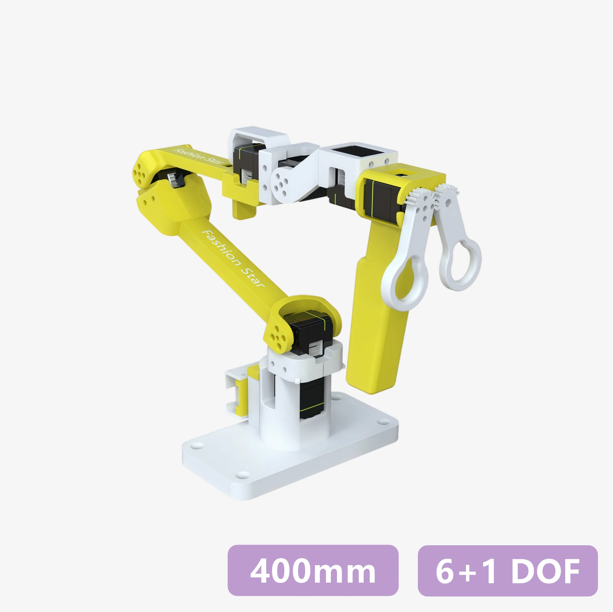</a>
  <a href="images/piper-mate-main-image-02.webp">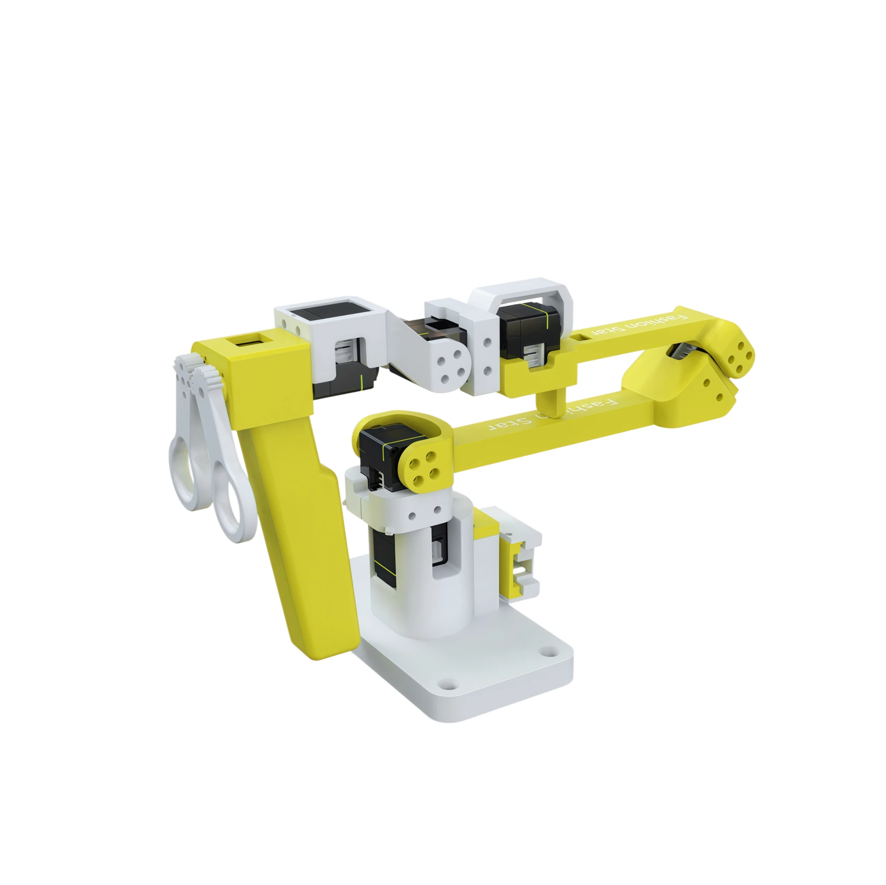</a>
  <a href="images/piper-mate-main-image-03.webp">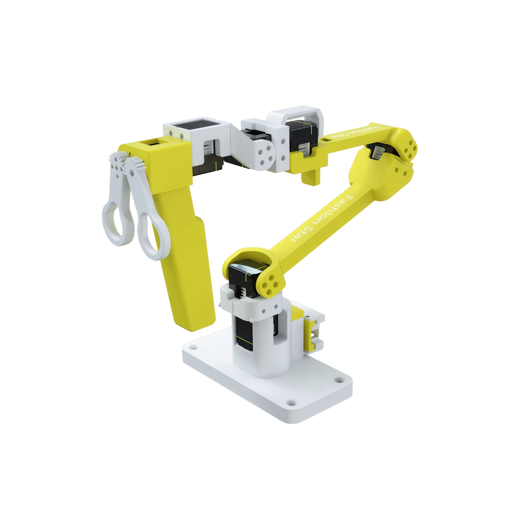</a>
  <a href="images/piper-mate-main-image-04.webp">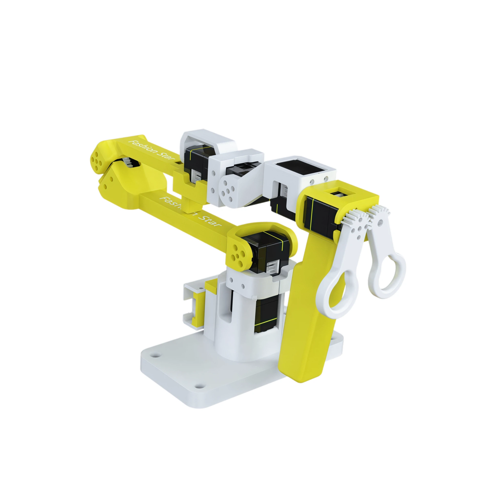</a>
  <a href="images/piper-mate-main-image-05.webp">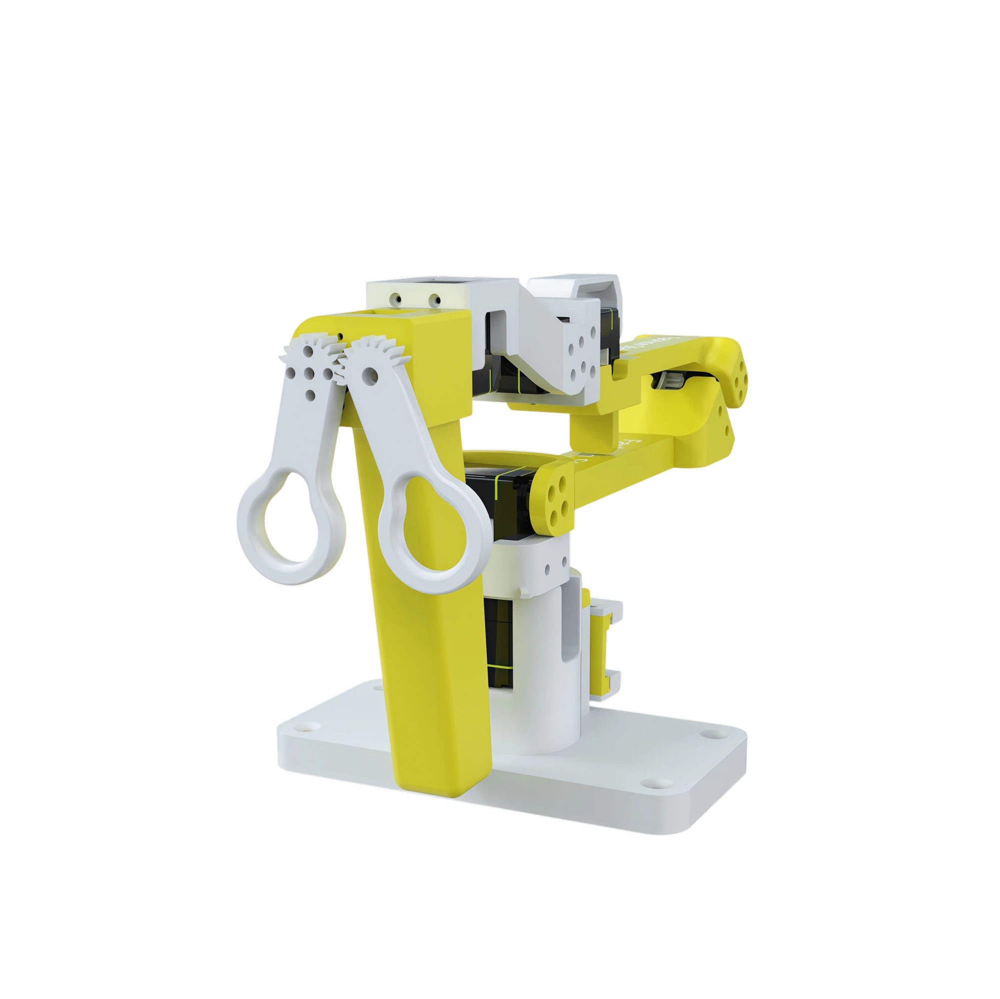</a>

**本页导航：**

- [📂 下载资料](#resources)
- [🔧 规格](#specifications)
- [📋 物料清单](#bill-of-materials)
- [📐 尺寸图](#dimensions)

## 下载资料

| 目录 | 说明 | 状态 |
| --- | --- | --- |
| [step/](step/) | assembly/ 为整机装配（`piper-mate.step`、`piper-mate-c050.step`）；parts/ 为 11 个零件模型 | ✅ 完整 |
| [stl/](stl/) | [下载全部 STL（11 个零件）](stl/downloads/piper-mate-stl-2026-10-27.zip?raw=true) · [浏览单个 STL](stl/) | ✅ 完整 |
| [drawings/](drawings/) | PDF 与 DWG 尺寸图 | ✅ 完整 |

整机装配模型为通用 CAD 参考；它与各零件文件的版本对应关系尚未完全验证。装配 STEP 与全部 11 份零件文件基于 2026-10-27 发布文件夹；几何未改，仅将 PRODUCT 名称统一为下列标识。

装配设计树把打印件归入 `3D Printed Parts (11)`，七个舵机归入 `Servos (7)`；舵机名称为 `J1-ID0-RP6-U15H-M` 至 `J7-ID6-RP6-U15H-M (Handle)`。打印件名称为 `piper-mate-base`、`piper-mate-link 1`–`5`、`piper-mate-handle`、`piper-mate-finger-ring-right`／`left`，UC-01 前壳与安装板也在此组；对应零件文件使用同名标识，`piper-mate-link 1`–`5` 在文件名中去掉空格，写作 `piper-mate-link1`–`5`。

C050 变体见 [assembly/piper-mate-c050.step](step/assembly/piper-mate-c050.step)。它沿用 102 风格分组：`3D Printed Parts (11)`、`Servos (7)`、`Servo Horns (11)`；打印件使用 `piper-mate-c050-` 前缀，七个舵机带 `J1`–`J7` 实例名。下方 BOM 仍按标准装配维护。

便携的打印入口是 [stl/](stl/)：11 个独立二进制 STL，外加一个包含同样 11 个文件的压缩包；每个散件与包内条目逐字节一致。

## 规格

| 规格 | PiPER-Mate 主臂 |
| --- | --- |
| 臂展／自由度 | 400 mm／6 个手臂关节 + 1 个手柄输入 |
| 关节舵机 | RP6-U15H-M × 7 |
| 位置检测 | 12-bit 绝对值编码器 |
| 通信 | UART 总线、UC-01 USB 接口；示例波特率 1,000,000 |
| 电源 | 12 V、3 A、DC5521 |
| 机械臂重量 | 500 g |
| 从臂连接 | AgileX PiPER 经 USB 转 CAN 连接，1 Mbit/s |

商品规格的关节编号从 0 开始，下表把它与软件从 1 开始的关节名称对应起来。机械行程与从臂指令限位用途不同。

| 舵机 ID／关节 | 产品机械行程 | Python／LeRobot 从臂指令限幅 | 方向 |
| --- | --- | --- | --- |
| 0 / joint1 | −154° 至 +154° | −150° 至 +150° | 反向 |
| 1 / joint2 | 0° 至 195° | 0° 至 180° | 正向 |
| 2 / joint3 | −175° 至 0° | −170° 至 0° | 正向 |
| 3 / joint4 | −102° 至 +102° | −100° 至 +100° | 反向 |
| 4 / joint5 | −142° 至 +142° | −70° 至 +70° | 正向 |
| 5 / joint6 | −120° 至 +120° | −120° 至 +120° | 反向 |

依据：[Python 映射](../Python_SDK/piper_pipermate.py)和 [LeRobot 映射](../Lerobot/lerobot_teleoperator_pipermate/lerobot_teleoperator_pipermate/config_starai_pipermate.py)。各软件路径对手柄输入的换算不同，请参阅对应指南。未核对从臂前，不要将软件限位扩大至主臂机械行程。

## 物料清单

BOM 共 **31 项**：第 1–21 项为装机物料，第 22–31 项为随箱配件／包装。舵机置于首行；打印零件标识与 STEP、STL 文件名一致，描述列保留原 BOM 标识。

这里不记录打印参数：请从 [stl/](stl/) 取模型，按自己的打印机切片，因为层高、壁数和填充取决于机器与耗材。

紧固件图片为示意，部分展示的是同头型的其他长度或螺纹；采购时以规格列为准。

| 序号 | 零件名称 | 型号／规格／零件标识 | 图片 | 说明 | 数量 |
| :---: | --- | --- | :---: | --- | :---: |
| 1 | UART 总线舵机 | RP6-U15H-M | <a href="images/rp6-u15h-m.png">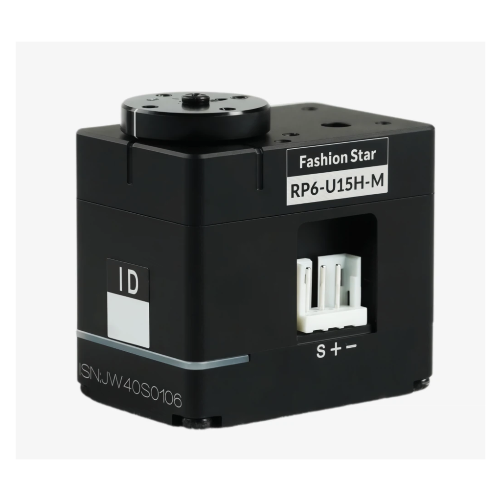</a> | 空心杯电机；12-bit 绝对值编码器；六个手臂关节＋手柄输入；J1–J7 | 7 |
| 2 | piper-mate-base | [piper-mate-base](step/parts/piper-mate-base.step) | <a href="images/base.png">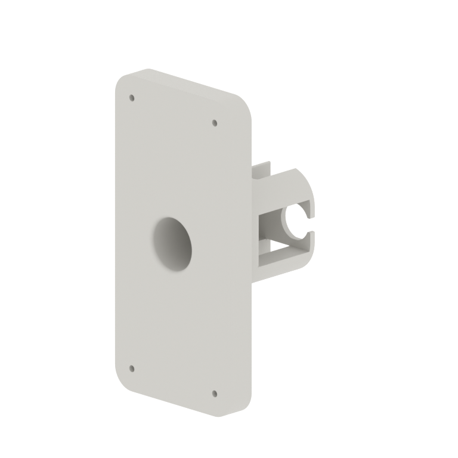</a> | 米白色 PLA 打印件；BOM 标识 `Piper mate_ID0` | 1 |
| 3 | piper-mate-link 1 | [piper-mate-link1](step/parts/piper-mate-link1.step) | <a href="images/link1.png">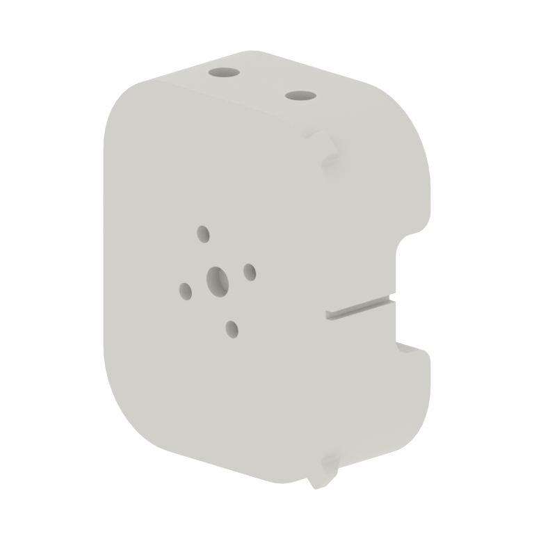</a> | 米白色 PLA 打印件；BOM 标识 `Piper mate_ID1` | 1 |
| 4 | piper-mate-link 2 | [piper-mate-link2](step/parts/piper-mate-link2.step) | <a href="images/link2.png">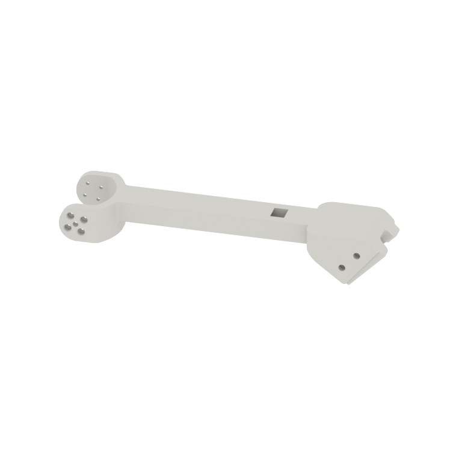</a> | 米白色 PLA 打印件；BOM 标识 `Piper mate_ID2` | 1 |
| 5 | piper-mate-link 3 | [piper-mate-link3](step/parts/piper-mate-link3.step) | <a href="images/link3.png">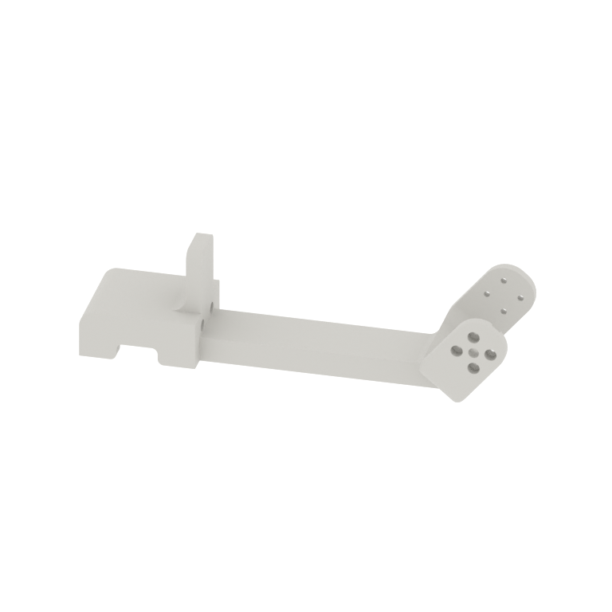</a> | 米白色 PLA 打印件；BOM 标识 `Piper mate_ID3` | 1 |
| 6 | piper-mate-link 4 | [piper-mate-link4](step/parts/piper-mate-link4.step) | <a href="images/link4.png">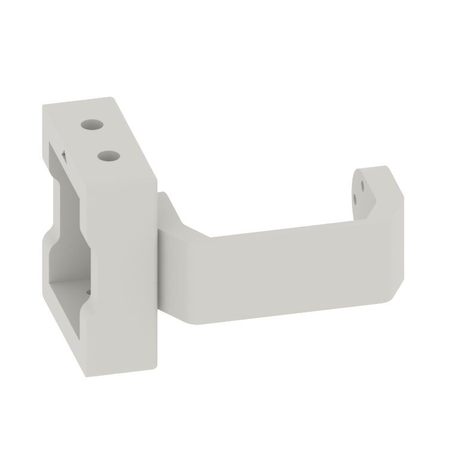</a> | 米白色 PLA 打印件；BOM 标识 `Piper mate_ID4` | 1 |
| 7 | piper-mate-link 5 | [piper-mate-link5](step/parts/piper-mate-link5.step) | <a href="images/link5.png">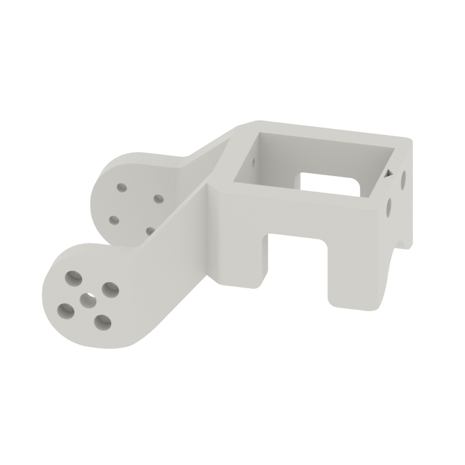</a> | 米白色 PLA 打印件；BOM 标识 `Piper mate_ID5` | 1 |
| 8 | piper-mate-handle | [piper-mate-handle](step/parts/piper-mate-handle.step) | <a href="images/trigger.png">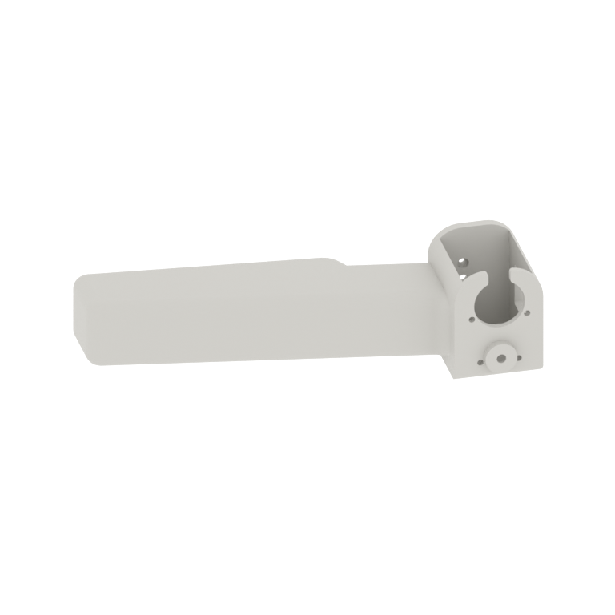</a> | 米白色 PLA 打印件；BOM 标识 `Piper mate_ID6-0` | 1 |
| 9 | piper-mate-finger-ring-right | [piper-mate-finger-ring-right](step/parts/piper-mate-finger-ring-right.step) | <a href="images/finger-ring-1.png">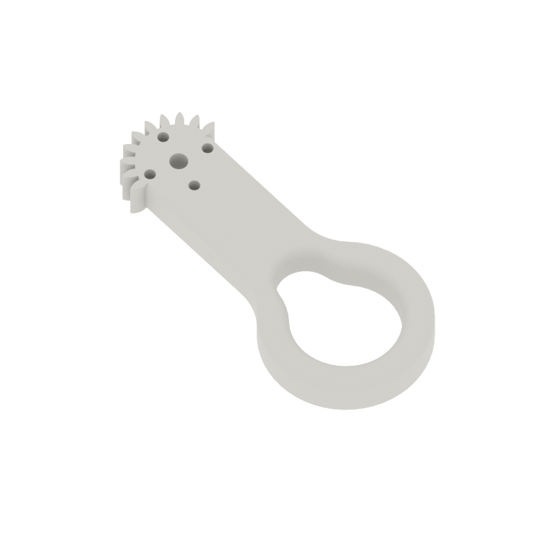</a> | 米白色 PLA 打印件；BOM 标识 `Piper mate_ID6-1` | 1 |
| 10 | piper-mate-finger-ring-left | [piper-mate-finger-ring-left](step/parts/piper-mate-finger-ring-left.step) | <a href="images/finger-ring-2.png">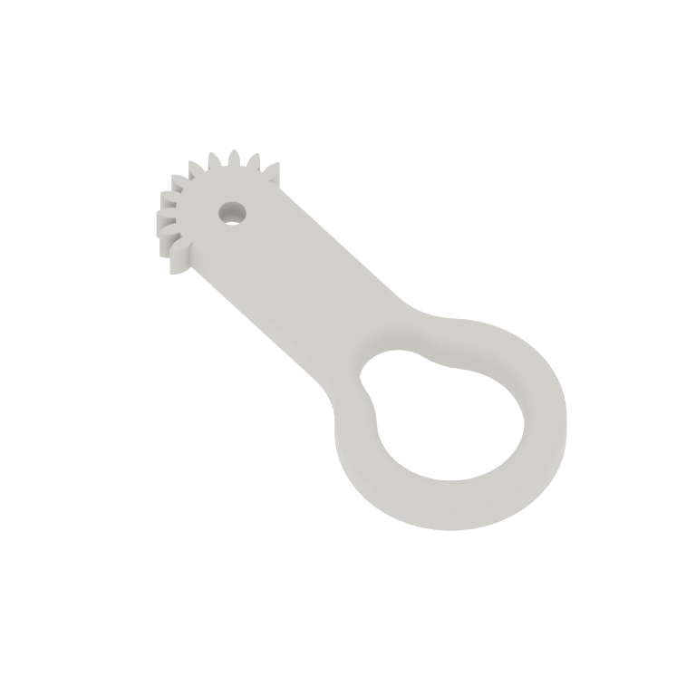</a> | 米白色 PLA 打印件；BOM 标识 `Piper mate_ID6-2` | 1 |
| 11 | piper-mate-uc01-front-case | [piper-mate-uc01-front-case](step/parts/piper-mate-uc01-front-case.step) | <a href="images/uc01-front-case.png">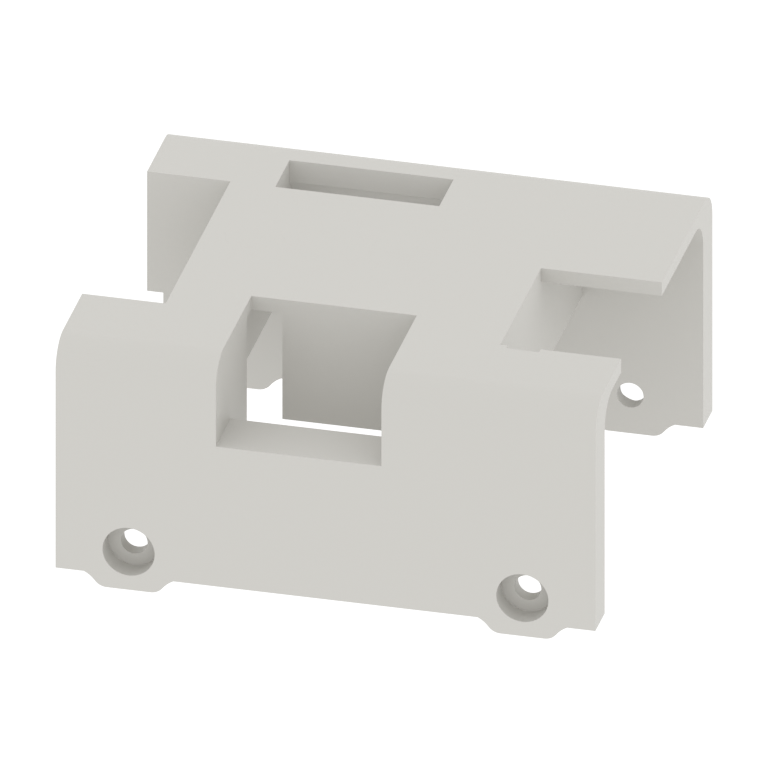</a> | 米白色 PLA 打印件；UC-01 外壳前壳 | 1 |
| 12 | piper-mate-uc01-mount | [piper-mate-uc01-mount](step/parts/piper-mate-uc01-mount.step) | <a href="images/uc01-mount.png">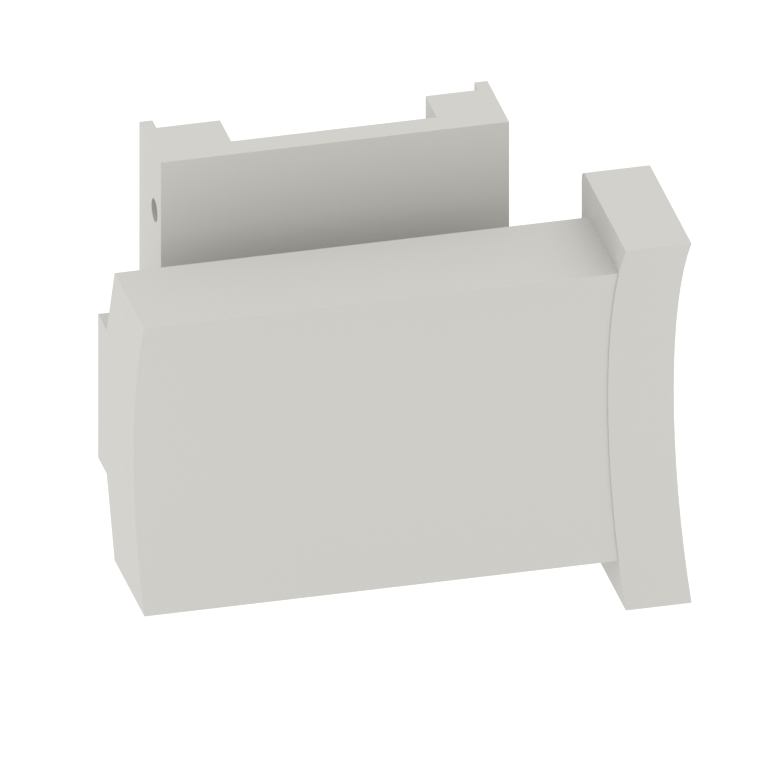</a> | 米白色 PLA 打印件；UC-01 安装板 | 1 |
| 13 | 舵机连接线 | A2007H03 × 2 100 mm | 待补 | 两端接头方向相反 | 4 |
| 14 | 舵机连接线 | A2007H03 × 2 140 mm | 待补 | 两端接头方向相反 | 1 |
| 15 | 舵机连接线 | A2007H03 × 2 250 mm | 待补 | 两端接头方向相反 | 1 |
| 16 | 转接线 | A2007H03 转 PH2.0 100 mm | 待补 | 两端接头方向相同 | 1 |
| 17 | 内六角圆柱头螺钉 | PM M1.6 × 4 mm |  | 黑色；12.9 级 | 8 |
| 18 | 十字槽盘头螺钉 | PM M1.6 × 4 mm |  | 黑色 | 54 |
| 19 | 十字槽沉头螺钉 | M3 × 10 | 待补 | 黑色 | 1 |
| 20 | 防松螺母 | M3 |  | 黑色 | 1 |
| 21 | TTL／USB 舵机适配器 | UC-01 | <a href="images/uc-01.webp">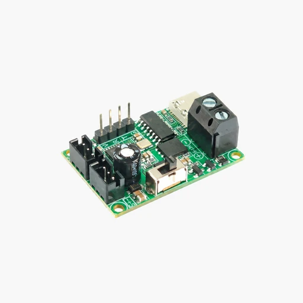</a> | PCBA，带 DC5521 母头电源线；线径 0.75 mm²，长 150 mm | 1 |
| 22 | 白盒 | 160 × 125 × 60 mm | 待补 | 小白盒包装 | 1 |
| 23 | 密封袋 | 120 × 80 mm | 待补 | 装螺丝胶；标签写“Threadlocker 1pcs／螺丝胶” | 1 |
| 24 | 螺丝胶 | 紫色 222 低强度 | 待补 | — | 1 |
| 25 | 备用电源线 | XT30 公头，10 cm | 待补 | — | 1 |
| 26 | 数据线 | USB-A 转 USB-C，1 m，黑色，1 A | 待补 | — | 1 |
| 27 | 木工夹 | 4 寸 F 夹 | 待补 | — | 2 |
| 28 | UC-01 裸板 | UC-01，不配电源线 | 待补 | — | 1 |
| 29 | 舵机连接线 | A2007H03 × 2 250 mm | 待补 | 两端接头方向相反；备用 | 1 |
| 30 | 十字槽螺丝 | M1.6 × 4 mm，12.9 级 | 待补 | 小密封袋标签“Phillips Screw M1.6*4, 5pcs” | 5 |
| 31 | 十字槽螺丝 | M1.6 × 4 mm | 待补 | 小密封袋标签“Phillips Screw M1.6*4, 8pcs” | 8 |

UC-01 前壳和安装板列在第 11–12 项，STEP 与 STL 文件分别在 [step/parts/](step/parts/) 和 [stl/](stl/)。请按实际配置确认适配关系。整机装配模型不额外计作一个物料。

第 22–31 项随套件包装，但不安装在机械臂上。实际套件内容请以订单为准。

## 尺寸图

[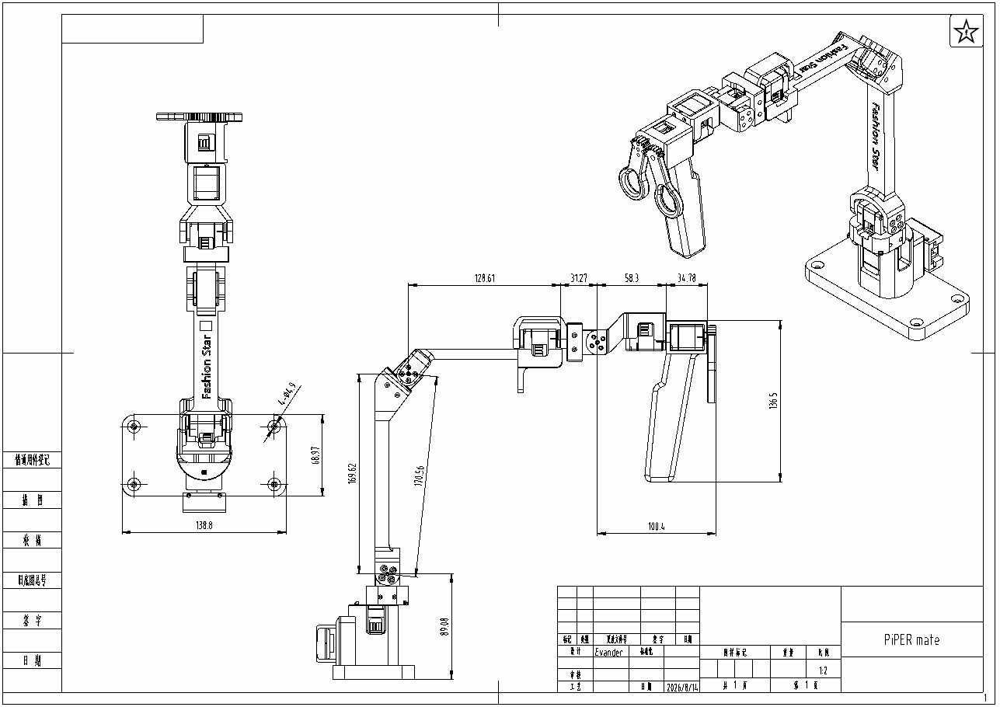](drawings/piper-mate.pdf)

打开 [PDF](drawings/piper-mate.pdf) 查看尺寸，或使用 [DWG](drawings/piper-mate.dwg) 进行 CAD 编辑。制作前请核对图纸与所选模型的版本一致性。

## 许可

硬件许可尚未确定。复制或改名文件不构成新的许可授权。

这些资料有错误或需要帮助？请携带型号和相关文件／条目联系[支持中心](https://fashionstar.com.hk/support/)。
